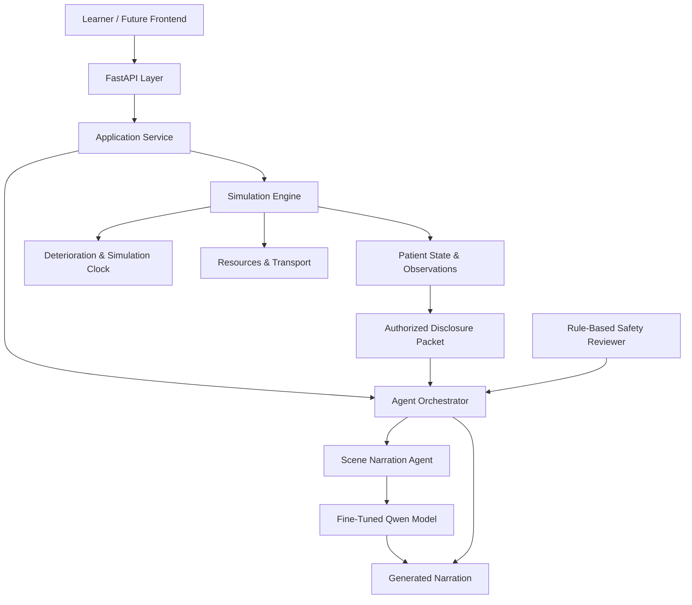

# SceneOps — AI-Powered Mass-Casualty Simulation & Scene Narration

**An AI-assisted mass-casualty incident simulation platform combining a deterministic simulation engine with fine-tuned language models for structured scene narration.**

Adapter loading:


Training completion:


Scene narration output:


Temporal narration output


Dataset composition graph:


Held-out test — EXACT MATCH: True


Temporal narration graph:


---

## Overview

SceneOps is a simulation and AI narration project designed for educational mass-casualty incident training.

It provides a simulated emergency scene in which multiple patients, observations, resources, transport operations, and time-dependent changes are managed by a deterministic simulation engine.

A fine-tuned language model converts authorized simulator observations into readable scene descriptions and temporal updates.

The central architectural principle is:

**The simulator owns the truth. The language model owns the narration.**

The LLM does not control the simulation, modify patient states, make triage decisions, or invent hidden information. Its responsibility is limited to generating natural-language descriptions from the information explicitly disclosed to it.

SceneOps is an educational simulation project, not a clinical decision-support system or a replacement for professional emergency medical judgment.

## Project Objectives

- Build a deterministic mass-casualty simulation engine.
- Represent multiple patients and their changing simulation states.
- Simulate patient deterioration and resource constraints.
- Track learner-recorded observations and patient interactions.
- Generate scene narration using a fine-tuned language model.
- Generate temporal narration describing what changed and what remained stable.
- Keep AI-generated language separate from simulator decisions.
- Build a reliable backend foundation that can support a future interactive frontend.

## System Architecture

SceneOps follows a layered architecture that separates simulation logic, application orchestration, AI agents, and API access.



### Core architectural components

| Component                | Responsibility                                          |
| ------------------------ | ------------------------------------------------------- |
| Simulator                | Maintains simulation state and deterministic rules      |
| Patient system           | Manages patient profiles, observations, and state       |
| Deterioration engine     | Handles time-dependent patient changes                  |
| Resource management      | Tracks ambulances and transport operations              |
| Disclosure layer         | Controls which observations are available to AI agents  |
| Agent orchestrator       | Coordinates narration and safety review                 |
| Scene narration agent    | Generates natural-language scene descriptions           |
| FastAPI backend          | Exposes simulation and agent functionality through APIs |
| vLLM backend integration | Provides a model-serving integration point              |

### Why this separation matters

Using an LLM as the source of truth for patient states or resource allocation would introduce unnecessary uncertainty into a simulation that requires deterministic behavior.

SceneOps instead uses Python-based simulation logic for state transitions and resource management. The model receives only authorized information and generates language from it.

This separation makes simulation behavior independently testable and helps prevent unsupported AI-generated information from being treated as ground truth.

## Technology Stack

| Area                      | Technologies                 |
| ------------------------- | ---------------------------- |
| Programming language      | Python                       |
| Backend API               | FastAPI, Uvicorn             |
| Data validation           | Pydantic                     |
| HTTP communication        | HTTPX                        |
| AI model                  | Qwen2.5-1.5B-Instruct        |
| Fine-tuning               | Hugging Face TRL, PEFT       |
| Fine-tuning method        | LoRA / QLoRA                 |
| Model development         | PyTorch, Transformers        |
| Dataset processing        | Python, JSONL                |
| Quantization experiments  | AWQ, GGUF                    |
| Model serving experiments | Ray Serve, vLLM integration  |
| Testing                   | Pytest, pytest-asyncio       |
| Code quality              | Ruff                         |
| GPU experimentation       | Kaggle GPU (NVIDIA Tesla T4) |

## AI Model Development

### Base model

`Qwen/Qwen2.5-1.5B-Instruct`

The project uses a small instruction-tuned language model to generate structured narration while keeping the model footprint manageable for experimentation.

### Fine-tuning approach

The model was fine-tuned using parameter-efficient adaptation rather than updating every parameter of the base model.

The training workflow included:

1. Preparing structured narration examples.
2. Validating generated examples.
3. Splitting data into training, validation, and test sets.
4. Fine-tuning using LoRA/QLoRA.
5. Saving adapter checkpoints.
6. Exploring quantized model exports.
7. Testing model inference and serving workflows.

### Primary fine-tuning objectives

The main objectives are:

**1. Scene narration**

Convert a snapshot of learner-recorded observations into a structured description of the current simulation scene.

**2. Temporal scene narration**

Describe changes between simulation time points, distinguishing changed observations from stable observations.

Patient dialogue style selection remains deterministic in Python and is not a primary fine-tuning objective.

## Dataset Engineering

The narration dataset was generated using a scenario-based pipeline.

### Dataset summary

| Dataset metric            | Value |
| ------------------------- | ----: |
| Unique narration examples | 5,856 |
| Scenarios                 |   320 |
| Training examples         | 3,554 |
| Training scenarios        |   192 |
| Validation examples       | 1,121 |
| Validation scenarios      |    64 |
| Test examples             | 1,181 |
| Test scenarios            |    64 |

### Narration distribution

| Example type       |     Count |
| ------------------ | --------: |
| Scene narration    |     2,801 |
| Temporal narration |     3,055 |
| **Total**          | **5,856** |

The temporal narration examples include both changed and stable observations.

### Data quality and leakage prevention

The dataset pipeline included:

- Duplicate detection and removal.
- Structured validation of generated examples.
- Scenario-level dataset splitting.
- Scenario-level overlap checks across training, validation, and test sets.

The reported scenario-level leakage audit passed for all three dataset comparisons:

- Training vs. validation
- Training vs. test
- Validation vs. test

The separation is important because randomly splitting individual examples from the same scenario could allow closely related examples to appear in multiple datasets.

## Model Evaluation

Model inference was tested using the LoRA adapter available in the Kaggle training artifacts.

### Evaluation environment

| Configuration     | Value                       |
| ----------------- | --------------------------- |
| Base model        | Qwen2.5-1.5B-Instruct       |
| Evaluated adapter | checkpoint-223              |
| GPU               | NVIDIA Tesla T4             |
| GPU memory        | Approximately 14.56 GB      |
| Framework         | PyTorch, Transformers, PEFT |

### Initial held-out evaluation

A held-out example from the test dataset was passed through the model using its original system and user messages.

| Evaluation result | Value |
| ----------------- | ----: |
| Samples evaluated |     1 |
| Exact matches     |     1 |
| Exact-match rate  |  100% |

The generated narration matched the dataset reference exactly.

### 20-sample evaluation

A subsequent batch evaluation was performed on 20 examples from the held-out test dataset.

| Metric                  |                             Result |
| ----------------------- | ---------------------------------: |
| Test examples evaluated |                                 20 |
| Exact matches           |                                 20 |
| Exact-match rate        |                             100.0% |
| Total inference time    | Approximately 2 minutes 45 seconds |
| Average inference time  |  Approximately 8.25 seconds/sample |

**Evaluation qualification:** This is an initial 20-sample evaluation, not a full evaluation of all 1,181 test examples. Exact-match performance on a small subset does not establish generalization, clinical safety, or overall model accuracy. Further evaluation across the complete test set and more challenging scenarios is required.

### Evaluation artifacts

The batch evaluation generated:

`sceneops_20_sample_evaluation.json`

This file contains the generated predictions, reference outputs, and exact-match results for the evaluated examples.

## Backend API

The FastAPI backend provides endpoints for interacting with simulation sessions and narration functionality.

Implemented API functionality includes:

| Endpoint / functionality | Purpose                                             |
| ------------------------ | --------------------------------------------------- |
| `/health`                | Backend health check                                |
| Session creation         | Create a simulation session                         |
| Session retrieval        | Retrieve session information                        |
| Session lifecycle        | Start, pause, resume, complete, and delete sessions |
| Simulation advancement   | Advance simulation time                             |
| Patient dialogue         | Handle patient interaction                          |
| Patient observation      | Retrieve authorized patient observations            |
| Scene narration          | Generate a scene description                        |
| Patient questions        | Record learner questions to patients                |

The backend is organized into API, application, agent, simulator, and serving modules.

## Model Serving & Quantization Experiments

Beyond adapter-based inference, the project explored model deployment and optimization workflows.

These experiments included:

- AWQ quantization.
- GGUF Q4_K_M conversion.
- Ray Serve integration.
- vLLM backend integration.
- API-based generation smoke testing.

These are engineering experiments and integration milestones. They should not be interpreted as proof of production-scale deployment or production performance.

## Testing & Code Quality

The simulator and backend have been tested using Pytest.

**Latest recorded test result:**

```text
459 passed, 3 warnings in 9.17s
```

The test suite covers simulation behavior, patient state management, resource allocation, API behavior, and related application logic.

The three warnings were recorded during the test run and should be reviewed as dependencies and API usage evolve.

## Repository Structure

The project is organized into the following major modules:

```text
SceneOps/
│
├── src/
│   └── sceneops/
│       ├── agents/
│       │   ├── backend.py
│       │   ├── contracts.py
│       │   ├── conversation_controller.py
│       │   ├── conversation_memory.py
│       │   ├── disclosure.py
│       │   ├── disclosure_rules.py
│       │   ├── orchestrator.py
│       │   ├── patient_dialogue.py
│       │   ├── safety_reviewer.py
│       │   └── scene_narration.py
│       │
│       ├── api/
│       │   ├── main.py
│       │   ├── schemas.py
│       │   └── session_manager.py
│       │
│       ├── application/
│       │   └── service.py
│       │
│       ├── evaluation/
│       │
│       ├── serving/
│       │   └── vllm_backend.py
│       │
│       ├── simulator/
│       │   ├── clock.py
│       │   ├── deterioration.py
│       │   ├── engine.py
│       │   ├── observations.py
│       │   ├── patients.py
│       │   ├── resources.py
│       │   ├── scenario.py
│       │   ├── scenario_builder.py
│       │   ├── transport.py
│       │   └── triage.py
│       │
│       └── training/
│           ├── dataset.py
│           ├── splitting.py
│           ├── scene_narration_dataset.py
│           ├── temporal_scene_narration_dataset.py
│           ├── temporal_scene_narration_dataset_v2.py
│           ├── temporal_scene_narration_dataset_v3.py
│           └── validators and evaluators
│
├── tests/
├── notebooks/
├── docs/
├── requirements.txt
├── pyproject.toml
└── README.md
```

*This is a high-level representation of the source modules; individual filenames and optional artifacts may vary across project revisions.*

## Local Setup

### Prerequisites

- Python 3.12
- Git
- A compatible Python environment
- GPU recommended for local model inference; CPU-only execution may be slower

### Clone the repository

```bash
git clone https://github.com/Priyanshu7439/SceneOps.git
cd SceneOps
```

### Create a virtual environment

Windows:

```bash
python -m venv .venv
.venv\Scripts\activate
```

Linux / macOS:

```bash
python3 -m venv .venv
source .venv/bin/activate
```

### Install dependencies

```bash
python -m pip install --upgrade pip
pip install -r requirements.txt
```

### Run tests

```bash
python -m pytest -q
```

**Note:** Full model inference additionally requires access to the base model and the corresponding trained adapter artifacts. The model artifacts are not assumed to be included in the source repository.

For API startup, use the FastAPI application entry point in `src/sceneops/api/main.py` and the project's configured environment.

## Screenshots & Demonstrations

Screenshots from actual Kaggle inference runs will be maintained in:

```text
assets/
└── screenshots/
    ├── 01_gpu_environment.png
    ├── 02_model_loading.png
    ├── 03_scene_narration.png
    ├── 04_temporal_narration.png
    ├── 05_heldout_exact_match.png
    └── 06_batch_evaluation.png
```

Once the images are added to the repository, they can be displayed here.

### Model loading


### Scene and temporal narration


### Held-out test inference


### Initial batch evaluation


These screenshots are intended as implementation evidence, not as a substitute for a complete evaluation report.

## Current Development Status

| Area                                    | Status                                |
| --------------------------------------- | ------------------------------------- |
| Deterministic simulation engine         | Implemented and tested                |
| Patient and observation management      | Implemented                           |
| Deterioration and resource management   | Implemented                           |
| Disclosure and narration architecture   | Implemented                           |
| Narration dataset generation            | Completed for current dataset version |
| LoRA/QLoRA fine-tuning experiments      | Completed                             |
| Adapter-based inference                 | Verified                              |
| Initial held-out evaluation             | Completed on 20 samples               |
| AWQ/GGUF experiments                    | Completed                             |
| Ray Serve integration experiments       | Tested                                |
| Backend API                             | Implemented                           |
| Interactive frontend                    | Upcoming                              |
| End-to-end frontend/backend integration | Pending                               |
| Broader model evaluation                | Pending                               |

## What's Next?

### Upcoming: Interactive Frontend Development

The backend and simulation foundation are in place. The next major development phase is the **interactive frontend**, which is scheduled to begin shortly.

The planned frontend will provide a more accessible interface for interacting with the simulation rather than relying on API calls and notebook-based demonstrations.

Planned areas include:

- Interactive simulation dashboard.
- Real-time scene and patient information.
- Simulation clock and event visibility.
- Patient observation and interaction interfaces.
- Ambulance and resource visibility.
- AI-generated scene and temporal narration panels.
- Backend integration for simulation controls and session management.

The frontend has not been implemented yet. These are planned capabilities, not existing features.

Further work will also focus on larger-scale held-out evaluation, stronger difficult-case testing, and end-to-end verification.

## Safety & Intended Use

SceneOps is designed for educational simulation and software engineering experimentation.

- It does not provide real-world medical diagnosis.
- It does not recommend or prescribe patient treatment.
- It does not replace qualified medical professionals.
- The simulator remains the authoritative source of simulation state.
- The narration model is restricted to authorized observations.

Do not use this project to make real emergency medical decisions.

## Author

**Priyanshu Kumar**

Computer Science and Business Systems | AI/ML Engineering

GitHub: [@Priyanshu7439](https://github.com/Priyanshu7439)

Project Repository: [SceneOps](https://github.com/Priyanshu7439/SceneOps)

---

\<p align="center">
&#x20; \<b>SceneOps — Deterministic Simulation. AI-Powered Narration.\</b>
\</p>
