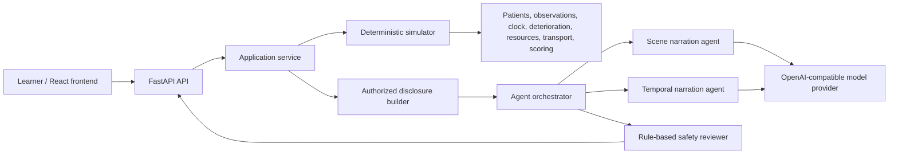

# SceneOps

SceneOps is an educational synthetic mass-casualty incident simulator with AI-assisted scene and temporal narration.

The learner manages simulated patients, authorized observations, deterioration, limited ambulances, transport, and time pressure. The Python simulator is the source of truth. The language model generates narration only from simulator-approved disclosures.
Historical project evidence screenshots contributed on the remote are preserved below:
Adapter loading:


Training completion:


Scene narration output:


Temporal narration output


Dataset composition graph:


Held-out test — EXACT MATCH: True


Temporal narration graph:


> **Safety boundary:** SceneOps is not a clinically validated diagnostic, treatment, triage, or emergency-response system.

## Current status

- Deterministic simulator, FastAPI backend, React/TypeScript frontend, narration agents, and rule-based safety reviewer are implemented.
- Latest local verification: **532 Python tests passed**, Ruff clean for `src`/`tests`, frontend lint passed, and frontend production build passed.
- Real local llama.cpp OpenAI-compatible inference was verified for scene and temporal narration.
- The fine-tuned model did **not** outperform the base model on preserved blind lexical F1.
- Ray Serve live inference, vLLM server inference, and remote W&B logging remain unverified.

## Screenshots

Manual screenshots are intentionally not fabricated. Add captures under [`docs/assets/screenshots/`](docs/assets/screenshots/) using its placeholder instructions. Suggested captures are dashboard, patient registry, observations, scene narration, temporal narration, event timeline/resources, and architecture.

## Architecture



### Responsibility boundary

| Python simulator owns | LLM may do |
|---|---|
| Patient state and deterioration | Turn authorized observations into prose |
| Clock and temporal progression | Describe recorded timestamps and values |
| Triage, assessment, resources, transport | Generate scene and temporal narration |
| Survival, outcomes, and scoring | Nothing beyond language generation |

The model never receives hidden simulator state and cannot allocate resources, decide treatment, alter survival, or override scoring. Generated text passes through a rule-based reviewer before returning from the API.

## Technology and layout

Python/FastAPI/Uvicorn/Pydantic/HTTPX; React/TypeScript/Vite; Qwen/Qwen2.5-1.5B-Instruct historical QLoRA; Transformers/TRL/PEFT/bitsandbytes; GGUF/AWQ experiments; Pytest/Ruff/oxlint.

```text
src/sceneops/{simulator,agents,application,api,serving,training,tracking}
frontend/             React + TypeScript + Vite
data/processed/       preserved narration dataset and manifest
artifacts/            evaluation reports and historical evidence
docs/                 architecture, reproducibility, safety, and audits
tests/                simulator, agent, API, serving, tracking, training
```

## Dataset

The authoritative manifest is [`data/processed/sceneops_narration_manifest.json`](data/processed/sceneops_narration_manifest.json).

| Split | Examples | Scenarios |
|---|---:|---:|
| Train | 3,554 | 192 |
| Validation | 1,121 | 64 |
| Test | 1,181 | 64 |
| **Total** | **5,856** | **320** |

The dataset contains 2,801 scene and 3,055 temporal examples. The manifest records a passed scenario-level leakage audit. Patient-dialogue datasets and style-selection code are preserved as experimental work, not silently presented as the primary narration objective.

See [`docs/DATASET.md`](docs/DATASET.md).

## Training and artifacts

Historical training used Qwen/Qwen2.5-1.5B-Instruct with QLoRA: rank 16, alpha 32, dropout 0.05, q/k/v/o/gate/up/down target modules, 4-bit NF4, 3 epochs, and 669 optimization steps, resumed from checkpoint-223. These facts are supported by the notebook audit. The original checkpoint and complete environment are not present here, so this is historical evidence rather than a fully reproducible local training run. No retraining is performed.

Historical exports include merged Hugging Face, AWQ, and GGUF Q4_K_M artifacts. The GGUF is intended for llama.cpp-compatible serving; GGUF compatibility with standard vLLM is not assumed.

See [`docs/TRAINING.md`](docs/TRAINING.md) and [`docs/MODEL_SERVING.md`](docs/MODEL_SERVING.md).

## Blind evaluation

Valid preserved runs: [`artifacts/evaluation/base_blind`](artifacts/evaluation/base_blind) and [`artifacts/evaluation/gguf_blind`](artifacts/evaluation/gguf_blind). Both used the same 1,181-example test set, dataset SHA-256, temperature 0, max tokens 256, and system/user-only prompts with assistant targets excluded.

| Metric | Base | Fine-tuned GGUF | Delta |
|---|---:|---:|---:|
| Overall token F1 | 0.6235269 | 0.5043650 | -11.9162 pp |
| Scene token F1 | 0.8181509 | 0.5649590 | -25.3192 pp |
| Temporal token F1 | 0.4468247 | 0.4493507 | +0.2526 pp |

Paired fine-tuned wins/losses/ties were 215/966/0 overall, 0/562/0 scene, and 215/404/0 temporal. Fine-tuning therefore did not improve preserved lexical F1. Lexical F1 is not a semantic, safety, or clinical correctness score. The older `artifacts/evaluation/gguf_final` output contains target leakage and is excluded from conclusions.

## State fidelity

The independent report records 1,181/1,181 strict-template checks passing for simulator-derived patient identity, timestamps, observation coverage, and values. This is a closed-grammar field evaluator, not broad semantic robustness or clinical validation. The detailed audit records seven temporal follow-command attribution errors, visible hemorrhage explicitly correct in 606/619 applicable examples, and 16 capillary-refill omissions where a value was available.

## Serving status

The verified local provider is llama.cpp exposing an OpenAI-compatible API:

```powershell
$env:SCENEOPS_VLLM_BASE_URL = "http://127.0.0.1:8081/v1"
$env:SCENEOPS_VLLM_MODEL = "auto"
```

`auto` resolves the sole model advertised by `/v1/models`; use the exact ID for a multi-model provider. Real scene and temporal narration passed through the backend and frontend proxy.

- Ray Serve: implementation plus mocked health/error/timeout tests; live model deployment unverified.
- vLLM: OpenAI-compatible client tested; live vLLM server inference and GGUF compatibility unverified.
- W&B: disabled/offline/mock-safe tracker tested; remote logging unverified.
- Axolotl: optional configuration structurally validated; no Axolotl training run executed.

See [`docs/MODEL_SERVING.md`](docs/MODEL_SERVING.md) and [`docs/EXPERIMENT_TRACKING.md`](docs/EXPERIMENT_TRACKING.md).

## Setup and run

```powershell
git clone https://github.com/Priyanshu7439/SceneOps.git
cd SceneOps
python -m venv .venv
.\.venv\Scripts\Activate.ps1
python -m pip install -r requirements.txt
```

Copy `.env.example` to `.env` only for local configuration. Never commit `.env` or credentials.

Backend:

```powershell
$env:PYTHONPATH = "src"
python -m uvicorn sceneops.api.main:app --host 127.0.0.1 --port 8001
```

Frontend:

```powershell
cd frontend
npm ci
$env:VITE_API_PROXY_TARGET = "http://127.0.0.1:8001"
npm run dev -- --host 127.0.0.1 --port 5173
```

Verification:

```powershell
$env:PYTHONPATH = "src"
python -m pytest -q
python -m ruff check src tests
npm run lint --prefix frontend
npm run build --prefix frontend
```

## Documentation

- [Architecture](docs/ARCHITECTURE.md) · [Dataset](docs/DATASET.md) · [Training](docs/TRAINING.md)
- [Evaluation](docs/EVALUATION.md) · [Model serving](docs/MODEL_SERVING.md) · [W&B](docs/EXPERIMENT_TRACKING.md)
- [Reproducibility](docs/REPRODUCIBILITY.md) · [Deployment](docs/DEPLOYMENT.md)
- [Safety and limitations](docs/SAFETY_AND_LIMITATIONS.md) · [Development](docs/DEVELOPMENT.md)
- [Evidence inventory](docs/EVIDENCE_INVENTORY.md) · [Completion audit](docs/completion/final_project_status.md)

## Responsible use

SceneOps uses synthetic educational scenarios. It is not clinically validated and must not be used to make real emergency decisions. Narration may be incomplete, rejected, or wrong; deterministic simulator rules remain authoritative.

## License and citation

No license is declared in this repository. Do not assume reuse permissions. No DOI or publication metadata is claimed.

## Architecture diagrams

The architecture is intentionally split into small diagrams so that each boundary remains readable on GitHub:

- [Layered system overview](docs/architecture/system-overview.md)
- [Simulation and narration workflow](docs/architecture/narration-workflow.md)
- [Dataset and fine-tuning pipeline](docs/architecture/dataset-pipeline.md)
- [Model-serving architecture](docs/architecture/model-serving.md)
- [Safety and trust boundaries](docs/architecture/safety-boundaries.md)

## AI Engineering and System Design

### Deterministic simulation, constrained language generation

SceneOps does not ask an LLM to simulate patients. `SimulationEngine` owns the clock, patient state, deterioration, observations, triage, resources, transport, events, scoring, and outcomes. `SceneOpsApplicationService` converts simulator-owned disclosures into typed agent requests. The narration agents produce language only, and `RuleBasedSafetyReviewer` checks the result before it reaches the UI. This separation makes state transitions reproducible, testable, and independent of provider availability.

### Two narration objectives

- **Scene narration** summarizes the authorized observations in a current window.
- **Temporal narration** compares authorized follow-up observations across timestamps, preserving patient attribution and distinguishing recorded facts from unavailable information.

Temporal narration therefore has stricter context requirements: the service constructs a bounded observation history, and the reviewer checks identities, timestamps, values, and prohibited decisions. Neither agent can change simulator state.

### Why a small model and parameter-efficient adaptation

The historical model is `Qwen/Qwen2.5-1.5B-Instruct`. A small instruction model is practical for local inference on constrained hardware and is sufficient for a narrow narration task; this repository does not claim it is better than larger models. Historical training used 4-bit NF4 loading with LoRA adapters rather than updating all base parameters. The recorded adapter configuration is rank 16, alpha 32, dropout 0.05, targeting `q_proj`, `k_proj`, `v_proj`, `o_proj`, `gate_proj`, `up_proj`, and `down_proj`.

### Why scenario-level splits and two evaluation families

Examples from the same scenario are related, so train/validation/test assignment is performed at scenario level to reduce leakage. Blind token F1 measures lexical overlap; the separate closed-grammar state-fidelity evaluator checks fields such as identity, timestamps, coverage, and values. Neither metric proves clinical validity or broad free-form semantic correctness. The fine-tuned model regressed on overall and scene lexical F1, while temporal F1 was nearly unchanged; that negative result is preserved in the evaluation reports.

### Provider abstraction and safety review

The FastAPI application uses an OpenAI-compatible provider client, so simulator code does not depend on a particular inference server. The locally verified path used llama.cpp with the existing GGUF. The repository also contains an optional Ray Serve adapter and a vLLM-compatible client path, but their live model-serving status is documented separately and is not inferred from the presence of code. Provider timeouts and failures are integration errors; they do not become simulator events or state mutations.

## Technology stack: actual use and verification

| Technology | Category | Why chosen | Actual SceneOps use | Verification status |
|---|---|---|---|---|
| Python | Backend/simulation | Strong typed ecosystem for deterministic domain logic | `src/sceneops/simulator`, application service, agents, API | Current tests passed |
| FastAPI + Pydantic | API | Explicit HTTP and schema validation | Session, patient, observation, resource, lifecycle, and narration routes | Current API tests passed |
| React + TypeScript + Vite | Frontend | Typed interactive operations dashboard | Registry, patient detail, observations, resources, timeline, narration, status | Lint/build passed; local workflow manually verified |
| Transformers | Model engineering | Model/tokenizer integration | Historical loading, tokenization, training and inference tooling | Historical pipeline evidence |
| TRL + PEFT | Fine-tuning | SFT trainer plus parameter-efficient adapters | Historical `SFTTrainer` with LoRA/QLoRA | Historical training verified; not rerun |
| bitsandbytes / NF4 | Fine-tuning efficiency | Lower memory base-model loading | Historical 4-bit NF4 QLoRA setup | Historical configuration evidence |
| AWQ / GGUF | Deployment artifacts | Runtime-oriented quantized formats | Historical AWQ and GGUF conversion; local GGUF served with llama.cpp | Artifact/history verified; runtime-specific |
| vLLM | Serving integration | OpenAI-compatible inference path | `VLLMBackend` client and configuration | Client/schema tested; live vLLM unverified |
| Ray Serve | Serving component | Optional deployment boundary for health/generation | `ray_serve_app.py` health/generate adapter | Mocked tests; live model loading unverified |
| Weights & Biases | Experiment tracking | Optional config/metric/checkpoint metadata tracking | Disabled/offline/online wrapper | Mock/offline tested; remote run unverified |
| Axolotl | Optional training path | Reproducible alternative configuration | Validated reference YAML only | Configuration validated; no training run |
| pytest + Ruff | Quality | Deterministic tests and static checks | Simulator, API, agents, serving, tracking, training config | 532 passed; Ruff clean |

## How the technology stack works together

The browser calls FastAPI through the Vite-configured API path. Pydantic validates the request, the application service obtains an authorized disclosure from `SimulationEngine`, and the agent orchestrator routes the task to scene or temporal narration. The provider client sends the prompt to the configured OpenAI-compatible runtime; the reviewer validates the returned text. React renders approved narration while all patient, resource, transport, and scoring state remains in Python.

For the historical ML workflow, Transformers supplied model/tokenizer integration, bitsandbytes supplied 4-bit NF4 loading, PEFT configured the LoRA adapter, and TRL ran supervised fine-tuning. The adapter was later merged and converted into AWQ/GGUF deployment artifacts. Evaluation scripts then compared blind base and fine-tuned outputs and ran a separate state-fidelity audit. W&B support records metadata and metrics when explicitly enabled, without automatically uploading datasets or weights.

See [Training](docs/TRAINING.md), [Evaluation](docs/EVALUATION.md), [Model serving](docs/MODEL_SERVING.md), and [Experiment tracking](docs/EXPERIMENT_TRACKING.md) for implementation-specific evidence and limitations.
