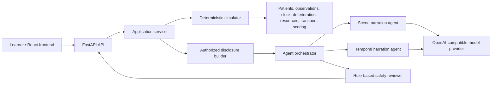

# SceneOps

SceneOps is an educational synthetic mass-casualty incident simulator with AI-assisted scene and temporal narration.

The learner manages simulated patients, authorized observations, deterioration, limited ambulances, transport, and time pressure. The Python simulator is the source of truth. The language model generates narration only from simulator-approved disclosures.

> **Safety boundary:** SceneOps is not a clinically validated diagnostic, treatment, triage, or emergency-response system.

## Current status

- Deterministic simulator, FastAPI backend, React/TypeScript frontend, narration agents, and rule-based safety reviewer are implemented.
- Latest local verification: **532 Python tests passed**, Ruff clean for `src`/`tests`, frontend lint passed, and frontend production build passed.
- Real local llama.cpp OpenAI-compatible inference was verified for scene and temporal narration.
- The fine-tuned model did **not** outperform the base model on preserved blind lexical F1.
- Ray Serve live inference, vLLM server inference, and remote W&B logging remain unverified.

## Screenshots

Manual screenshots are intentionally not fabricated. Add captures under [`docs/assets/screenshots/`](docs/assets/screenshots/) using its placeholder instructions. Suggested captures are dashboard, patient registry, observations, scene narration, temporal narration, event timeline/resources, and architecture.

## Architecture



### Responsibility boundary

| Python simulator owns | LLM may do |
|---|---|
| Patient state and deterioration | Turn authorized observations into prose |
| Clock and temporal progression | Describe recorded timestamps and values |
| Triage, assessment, resources, transport | Generate scene and temporal narration |
| Survival, outcomes, and scoring | Nothing beyond language generation |

The model never receives hidden simulator state and cannot allocate resources, decide treatment, alter survival, or override scoring. Generated text passes through a rule-based reviewer before returning from the API.

## Technology and layout

Python/FastAPI/Uvicorn/Pydantic/HTTPX; React/TypeScript/Vite; Qwen/Qwen2.5-1.5B-Instruct historical QLoRA; Transformers/TRL/PEFT/bitsandbytes; GGUF/AWQ experiments; Pytest/Ruff/oxlint.

```text
src/sceneops/{simulator,agents,application,api,serving,training,tracking}
frontend/             React + TypeScript + Vite
data/processed/       preserved narration dataset and manifest
artifacts/            evaluation reports and historical evidence
docs/                 architecture, reproducibility, safety, and audits
tests/                simulator, agent, API, serving, tracking, training
```

## Dataset

The authoritative manifest is [`data/processed/sceneops_narration_manifest.json`](data/processed/sceneops_narration_manifest.json).

| Split | Examples | Scenarios |
|---|---:|---:|
| Train | 3,554 | 192 |
| Validation | 1,121 | 64 |
| Test | 1,181 | 64 |
| **Total** | **5,856** | **320** |

The dataset contains 2,801 scene and 3,055 temporal examples. The manifest records a passed scenario-level leakage audit. Patient-dialogue datasets and style-selection code are preserved as experimental work, not silently presented as the primary narration objective.

See [`docs/DATASET.md`](docs/DATASET.md).

## Training and artifacts

Historical training used Qwen/Qwen2.5-1.5B-Instruct with QLoRA: rank 16, alpha 32, dropout 0.05, q/k/v/o/gate/up/down target modules, 4-bit NF4, 3 epochs, and 669 optimization steps, resumed from checkpoint-223. These facts are supported by the notebook audit. The original checkpoint and complete environment are not present here, so this is historical evidence rather than a fully reproducible local training run. No retraining is performed.

Historical exports include merged Hugging Face, AWQ, and GGUF Q4_K_M artifacts. The GGUF is intended for llama.cpp-compatible serving; GGUF compatibility with standard vLLM is not assumed.

See [`docs/TRAINING.md`](docs/TRAINING.md) and [`docs/MODEL_SERVING.md`](docs/MODEL_SERVING.md).

## Blind evaluation

Valid preserved runs: [`artifacts/evaluation/base_blind`](artifacts/evaluation/base_blind) and [`artifacts/evaluation/gguf_blind`](artifacts/evaluation/gguf_blind). Both used the same 1,181-example test set, dataset SHA-256, temperature 0, max tokens 256, and system/user-only prompts with assistant targets excluded.

| Metric | Base | Fine-tuned GGUF | Delta |
|---|---:|---:|---:|
| Overall token F1 | 0.6235269 | 0.5043650 | -11.9162 pp |
| Scene token F1 | 0.8181509 | 0.5649590 | -25.3192 pp |
| Temporal token F1 | 0.4468247 | 0.4493507 | +0.2526 pp |

Paired fine-tuned wins/losses/ties were 215/966/0 overall, 0/562/0 scene, and 215/404/0 temporal. Fine-tuning therefore did not improve preserved lexical F1. Lexical F1 is not a semantic, safety, or clinical correctness score. The older `artifacts/evaluation/gguf_final` output contains target leakage and is excluded from conclusions.

## State fidelity

The independent report records 1,181/1,181 strict-template checks passing for simulator-derived patient identity, timestamps, observation coverage, and values. This is a closed-grammar field evaluator, not broad semantic robustness or clinical validation. The detailed audit records seven temporal follow-command attribution errors, visible hemorrhage explicitly correct in 606/619 applicable examples, and 16 capillary-refill omissions where a value was available.

## Serving status

The verified local provider is llama.cpp exposing an OpenAI-compatible API:

```powershell
$env:SCENEOPS_VLLM_BASE_URL = "http://127.0.0.1:8081/v1"
$env:SCENEOPS_VLLM_MODEL = "auto"
```

`auto` resolves the sole model advertised by `/v1/models`; use the exact ID for a multi-model provider. Real scene and temporal narration passed through the backend and frontend proxy.

- Ray Serve: implementation plus mocked health/error/timeout tests; live model deployment unverified.
- vLLM: OpenAI-compatible client tested; live vLLM server inference and GGUF compatibility unverified.
- W&B: disabled/offline/mock-safe tracker tested; remote logging unverified.
- Axolotl: optional configuration structurally validated; no Axolotl training run executed.

See [`docs/MODEL_SERVING.md`](docs/MODEL_SERVING.md) and [`docs/EXPERIMENT_TRACKING.md`](docs/EXPERIMENT_TRACKING.md).

## Setup and run

```powershell
git clone https://github.com/Priyanshu7439/SceneOps.git
cd SceneOps
python -m venv .venv
.\.venv\Scripts\Activate.ps1
python -m pip install -r requirements.txt
```

Copy `.env.example` to `.env` only for local configuration. Never commit `.env` or credentials.

Backend:

```powershell
$env:PYTHONPATH = "src"
python -m uvicorn sceneops.api.main:app --host 127.0.0.1 --port 8001
```

Frontend:

```powershell
cd frontend
npm ci
$env:VITE_API_PROXY_TARGET = "http://127.0.0.1:8001"
npm run dev -- --host 127.0.0.1 --port 5173
```

Verification:

```powershell
$env:PYTHONPATH = "src"
python -m pytest -q
python -m ruff check src tests
npm run lint --prefix frontend
npm run build --prefix frontend
```

## Documentation

- [Architecture](docs/ARCHITECTURE.md) · [Dataset](docs/DATASET.md) · [Training](docs/TRAINING.md)
- [Evaluation](docs/EVALUATION.md) · [Model serving](docs/MODEL_SERVING.md) · [W&B](docs/EXPERIMENT_TRACKING.md)
- [Reproducibility](docs/REPRODUCIBILITY.md) · [Deployment](docs/DEPLOYMENT.md)
- [Safety and limitations](docs/SAFETY_AND_LIMITATIONS.md) · [Development](docs/DEVELOPMENT.md)
- [Evidence inventory](docs/EVIDENCE_INVENTORY.md) · [Completion audit](docs/completion/final_project_status.md)

## Responsible use

SceneOps uses synthetic educational scenarios. It is not clinically validated and must not be used to make real emergency decisions. Narration may be incomplete, rejected, or wrong; deterministic simulator rules remain authoritative.

## License and citation

No license is declared in this repository. Do not assume reuse permissions. No DOI or publication metadata is claimed.
