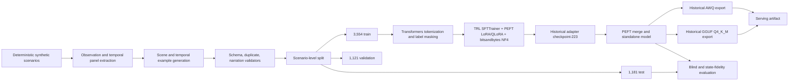

# Dataset and fine-tuning pipeline

This combines current repository code with historical notebook evidence. Training and conversion stages are historical unless a current artifact or test verifies them.

The manifest records 5,856 examples across 320 scenarios. Historical training records 3 epochs and 669 steps with rank 16, alpha 32, dropout 0.05, and q/k/v/o/gate/up/down modules. The original checkpoint and complete training environment are unavailable locally.
