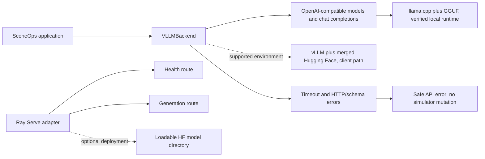

# Model-serving architecture

The application depends on a provider abstraction rather than embedding model-runtime logic in the simulator.

llama.cpp is the verified local provider. The vLLM client is tested, but live vLLM inference and GGUF-through-vLLM are unverified. Ray Serve health, failure, and timeout behavior is mocked-tested; live model loading is unverified.
