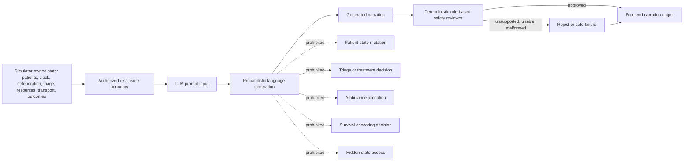

# Safety and trust boundaries

The application service constructs narration requests from simulator-approved observations. Provider failures and rejected narration do not call simulator mutation methods. This is a software safety boundary, not clinical validation.
